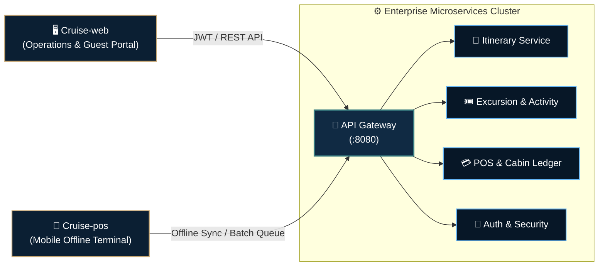

 

**Cruise, the maritime operations & hospitality cloud:** An open, multi-tier enterprise ecosystem engineered for luxury cruise liners and maritime services. Unifies itinerary navigation, shore excursions, SOLAS safety muster tracking, and offline-first cashless POS — optimized for ultra-low latency, mission-critical resilience, and editorial elegance.

 

---

### 🚢 Learn About Cruise Ecosystem ⚓ 🎓

- 📖 **Understand Core Operations**: Explore backend microservices in [`Cruise-api`](https://github.com/Cruise-JavaCLass/Cruise-api)
- 🖥️ **Explore the Web Experience**: Tour the luxury editorial dashboard and 3D digital twin in [`Cruise-web`](https://github.com/Cruise-JavaCLass/Cruise-web)
- 📱 **Inspect Point of Sale (POS)**: Review mobile RFID/NFC offline syncing in [`Cruise-pos`](https://github.com/Cruise-JavaCLass/Cruise-pos)
- 🛡️ **Security & Safety Standards**: Read our [Security Policy](SECURITY.md) and SOLAS emergency muster protocol
- 🤝 **Contribute to the Fleet**: Check our [Contributing Guide](CONTRIBUTING.md) and [Code of Conduct](CODE_OF_CONDUCT.md)

---

### 🏛️ Core Repositories & Subsystems

| Subsystem | Stack | Primary Responsibilities |
| :--- | :--- | :--- |
| **[`Cruise-api`](https://github.com/Cruise-JavaCLass/Cruise-api)** | Java 21 • Spring Boot 4.x • MySQL | **Maritime Intelligence Core:** Daily itinerary scheduling, shore excursion rosters, cabin billing accounts, and API Gateway routing. |
| **[`Cruise-web`](https://github.com/Cruise-JavaCLass/Cruise-web)** | React 19 • TypeScript • Tailwind 4 • Three.js | **Command Deck & Guest Portal:** Fleet operations dashboard, 3D maritime globe, digital boarding pass, and real-time activity bookings. |
| **[`Cruise-pos`](https://github.com/Cruise-JavaCLass/Cruise-pos)** | Android • Kotlin • Jetpack Compose | **Mobile POS Terminal:** Outlets, bars, and dining orders with local cache and adaptive satellite sync when connectivity drops. |

---

### 🗺️ System Dataflow & Synchronization

---

**[Cruise Hospitality Technology](https://github.com/Cruise-JavaCLass)** • Transforming Maritime Journeys Through Intelligent Engineering  
Cruise Management System © 2026. Licensed under MIT.

