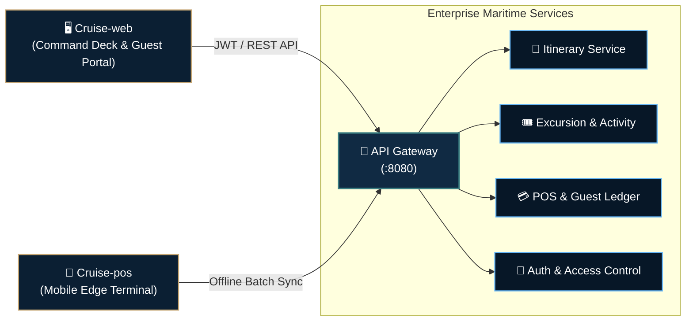

 

**Cruise Maritime Operations & Hospitality Platform:** An open enterprise ecosystem engineered for luxury cruise fleets. Seamlessly unifying high-concurrency itinerary navigation, excursion bookings, maritime safety protocols, and offline-first cashless POS.

 

  
  
  
  
  
  
  
  

---

### Architecture & Repositories

<table>
  <thead>
    <tr>
      <th width="30%">Repository</th>
      <th width="35%">Technology Stack</th>
      <th width="35%">Domain & Scope</th>
    </tr>
  </thead>
  <tbody>
    <tr>
      <td>
        <a href="https://github.com/Cruise-JavaCLass/Cruise-api">
          <b>Cruise-api</b>
        </a> 
        Backend Engine & Gateway
      </td>
      <td>
        <code>Java 21</code> &bull; <code>Spring Boot 4.x</code> 
        <code>Spring Security</code> &bull; <code>MySQL</code> &bull; <code>Redis</code>
      </td>
      <td>
        High-throughput API Gateway, daily itinerary navigation, excursion booking engine, and folio billing ledger.
      </td>
    </tr>
    <tr>
      <td>
        <a href="https://github.com/Cruise-JavaCLass/Cruise-web">
          <b>Cruise-web</b>
        </a> 
        Operations Deck & Guest Experience
      </td>
      <td>
        <code>React 19</code> &bull; <code>TypeScript</code> &bull; <code>Vite</code> 
        <code>Tailwind CSS 4</code> &bull; <code>Three.js</code> &bull; <code>TanStack Query</code>
      </td>
      <td>
        Fleet command dashboard, interactive 3D vessel digital twin, guest mobile-first portal, and real-time muster.
      </td>
    </tr>
    <tr>
      <td>
        <a href="https://github.com/Cruise-JavaCLass/Cruise-pos">
          <b>Cruise-pos</b>
        </a> 
        Mobile Edge Point of Sale
      </td>
      <td>
        <code>Android</code> &bull; <code>Kotlin</code> &bull; <code>Jetpack Compose</code> 
        <code>Room DB</code> &bull; <code>NFC / RFID</code> &bull; <code>Coroutines</code>
      </td>
      <td>
        Offline-first handheld POS for onboard lounges and dining, with satellite-adaptive batch synchronization.
      </td>
    </tr>
  </tbody>
</table>

---

### System Architecture & Sync Flow

---

### Resources & Governance

<table>
  <tr>
    <td width="33%" align="center">
      <b>📖 Documentation & APIs</b> 
      Explore microservices contracts and API schemas in <a href="https://github.com/Cruise-JavaCLass/Cruise-api">Cruise-api</a>.
    </td>
    <td width="33%" align="center">
      <b>🤝 Contributing</b> 
      Read our standards and branching strategy in <a href="CONTRIBUTING.md">CONTRIBUTING.md</a>.
    </td>
    <td width="33%" align="center">
      <b>🛡️ Security & Compliance</b> 
      Report vulnerabilities and review muster policies in <a href="SECURITY.md">SECURITY.md</a>.
    </td>
  </tr>
</table>

 

**[Cruise Hospitality Technology](https://github.com/Cruise-JavaCLass)** &bull; Engineered for Luxury Maritime Operations  
Cruise Management System &copy; 2026. Distributed under the MIT License.

