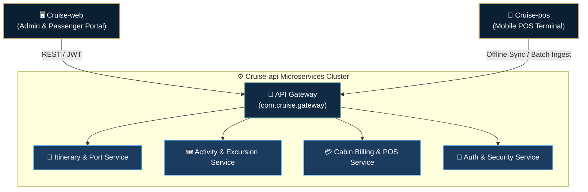

# 🚢 LUXURY CRUISE MANAGEMENT SYSTEM
### *Enterprise Maritime Operations, Digital Passenger Services & Offline POS Ecosystem*

 

> **Chào mừng đến với GitHub chính thức của Tổ hợp Giải pháp Quản lý Du Thuyền Quốc tế (Cruise Management System).**  
> Nền tảng điều phối số hóa toàn diện từ hải trình biển, kiểm soát khách lên tàu SOLAS, quản lý tour bờ, cho đến thanh toán ngoại tuyến POS trên biển viễn dương.

---

## 🌐 Hệ Sinh Thái & Các Phân Hệ Chính (Core Architecture)

Hệ thống được thiết kế theo kiến trúc phân tầng chuyên nghiệp (Multi-Repository Architecture), chia làm 3 phân hệ công nghệ cốt lõi:

| Phân hệ (Repository) | Nền tảng công nghệ | Mục tiêu & Nghiệp vụ trọng tâm |
| :--- | :--- | :--- |
| **[`Cruise-api`](https://github.com/Cruise-JavaCLass/Cruise-api)** | Java 21 • Spring Boot 4.x • MySQL • JPA | **Hạt nhân dịch vụ Backend:** Điều phối lịch trình hải trình (`itinerary`), quản lý hoạt động & tour trên bờ (`activity`), cổng định tuyến Gateway và quản lý hạn mức/đối soát giao dịch cabin (`pos-service`). |
| **[`Cruise-web`](https://github.com/Cruise-JavaCLass/Cruise-web)** | React 19 • TypeScript • Vite • Tailwind CSS 4 • Three.js | **Cổng thông tin Đa Phân Hệ:** Bảng điều khiển tác nghiệp thuyền trưởng & thủy thủ đoàn (Operations Dashboard), bản đồ hải trình 3D Digital Twin, và Cổng dịch vụ hành khách thượng lưu (Passenger Portal). |
| **[`Cruise-pos`](https://github.com/Cruise-JavaCLass/Cruise-pos)** | Android • Kotlin • Jetpack Compose | **Thiết bị thanh toán di động mPOS:** Phục vụ nhân viên quầy bar, nhà hàng, spa trên tàu. Hỗ trợ quét NFC/RFID thẻ phòng, quẹt mã QR và cơ chế tự động đồng bộ ngoại tuyến khi mất sóng vệ tinh. |

---

## 🏛️ Sơ Đồ Luồng Hoạt Động (System Workflow)

---

## ✨ Điểm Nổi Bật & Tiêu Chuẩn Kỹ Thuật (Engineering Standards)

- **Chuẩn Hàng Hải SOLAS**: Giám sát an toàn hành khách, điểm danh muster station khẩn cấp và cảnh báo giờ chót All-Aboard Watchdog.
- **Khả Năng Ngoại Tuyến (Offline-First)**: Đảm bảo vận hành quầy POS nhà hàng/quầy bar mượt mà ngay cả khi tàu ra vùng biển sâu mất kết nối Internet vệ tinh.
- **Trải Nghiệm Thượng Lưu (Luxury Maritime Identity)**: Giao diện chuẩn mực phong cách Editorial, tối ưu hiệu ứng hình học Three.js 3D mượt mà và trực quan.
- **Tiêu Chuẩn Mã Nguồn**: Kiểm thử tự động trên CI/CD GitHub Actions với Vitest, Oxlint, SonarCloud và CodeRabbit Review nghiêm ngặt.

---

Cruise Management System © 2026. All rights reserved.

