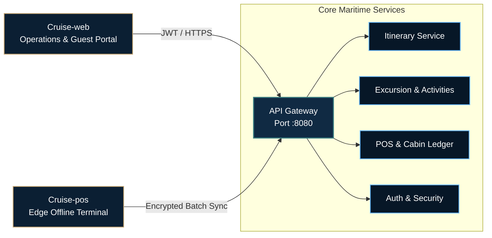

 

### Enterprise Maritime Cloud & Edge Operations

Cruise Hospitality Technology delivers an open-standard software infrastructure for passenger cruise liners. Engineered with strict fault tolerance, offline-first edge reliability, and sub-second maritime communications.

 

  
  &nbsp;
  
  &nbsp;
  
  &nbsp;
  

---

### Core Repositories & Subsystems

<table>
  <thead>
    <tr style="border-bottom: 2px solid #30363d;">
      <th align="left" width="28%">Repository</th>
      <th align="left" width="32%">Key Capabilities</th>
      <th align="left" width="40%">Technology Stack</th>
    </tr>
  </thead>
  <tbody>
    <tr>
      <td align="left">
        <a href="https://github.com/Cruise-JavaCLass/Cruise-api">
          <b>Cruise-api</b>
        </a>
         
        <small style="color: #8b949e;">Central Maritime Engine</small>
      </td>
      <td align="left">
        Itinerary navigation engine, cabin ledger reconciliation, excursion roster, and gateway security.
      </td>
      <td align="left">
        <code>Java 21</code> &bull; <code>Spring Boot 4.x</code> &bull; <code>MySQL</code> &bull; <code>Redis</code> &bull; <code>Docker</code>
      </td>
    </tr>
    <tr>
      <td align="left">
        <a href="https://github.com/Cruise-JavaCLass/Cruise-web">
          <b>Cruise-web</b>
        </a>
         
        <small style="color: #8b949e;">Operations & Guest Experience</small>
      </td>
      <td align="left">
        Fleet operations deck, 3D interactive vessel deck plans, passenger booking hub, and emergency muster.
      </td>
      <td align="left">
        <code>React 19</code> &bull; <code>TypeScript</code> &bull; <code>Vite</code> &bull; <code>Tailwind 4</code> &bull; <code>Three.js</code>
      </td>
    </tr>
    <tr>
      <td align="left">
        <a href="https://github.com/Cruise-JavaCLass/Cruise-pos">
          <b>Cruise-pos</b>
        </a>
         
        <small style="color: #8b949e;">Edge Handheld POS</small>
      </td>
      <td align="left">
        High-availability cashless checkout, RFID wristband tap, offline transaction spooling, and satellite batch sync.
      </td>
      <td align="left">
        <code>Kotlin</code> &bull; <code>Jetpack Compose</code> &bull; <code>Room DB</code> &bull; <code>Coroutines</code> &bull; <code>NFC</code>
      </td>
    </tr>
  </tbody>
</table>

---

### System Architecture & Sync Flow

---

### Developer & Governance Resources

<table>
  <tr>
    <td width="33%" align="left">
      <h4>Documentation</h4>
      
Microservice contracts, schema definitions, and OpenAPI documentation.

      <a href="https://github.com/Cruise-JavaCLass/Cruise-api">View Architecture &rarr;</a>
    </td>
    <td width="33%" align="left">
      <h4>Contributing</h4>
      
Engineering workflows, PR templates, and Git branching guidelines.

      <a href="CONTRIBUTING.md">Read Guidelines &rarr;</a>
    </td>
    <td width="33%" align="left">
      <h4>Security & SOLAS</h4>
      
Responsible disclosure policies and maritime safety compliance standards.

      <a href="SECURITY.md">Review Protocols &rarr;</a>
    </td>
  </tr>
</table>

 

**[Cruise Hospitality Technology](https://github.com/Cruise-JavaCLass)** &bull; Enterprise Maritime Systems  
Cruise Management System &copy; 2026. Distributed under the MIT License.

